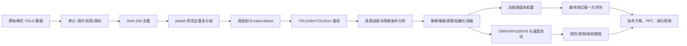

# 棉花病虫害视觉检测项目方案

## 最终要交付什么

项目最终交付一个可复现的「棉花病虫害巡检与边缘推理系统」，不是只交一张准确率表。它由以下成果组成：

1. 一份经过图像完整性检查、精确去重和视觉近重复分组的 YOLO 数据清单。原始图片不被移动或覆盖，清单、哈希和分组规则可复算。
2. YOLOv8n、YOLO11n 和轻量化/鲁棒改进模型的训练权重、验证和最终测试报告。报告包含每类 precision、recall、mAP50、mAP50–95、F1、混淆矩阵和漏检样例。
3. 一组困难条件结果：暗光、过曝、低对比度、模糊、遮挡、低分辨率，以及真实田间留出图。合成压力集只用于诊断，不能代替真实田间结果。
4. 一个本地网页和命令行推理工具，支持单张图片、视频和 USB 摄像头，导出标框图片、JSON 和 CSV。网页不使用微信小程序，也不要求上传到云端。
5. ONNX 导出文件、PyTorch/ONNX 数值一致性检查和目标设备上的端到端速度记录。记录模型文件大小、参数量、FP32/FP16/INT8、batch、输入尺寸、预处理、NMS、P50/P95 延迟和峰值内存。
6. 比赛材料：技术方案 PDF、答辩 PPT、3–5 分钟演示视频、代码仓库和可核验的运行记录。原始数据、未确认许可的权重和大型训练产物不放入 GitHub。

## 从数据到成品的工作流

### 1. 数据审计与标注语义

先运行 `cotton-doctor audit`，检查图片是否可解码、YOLO 五元组是否合法、类别 ID 是否越界、空标注和孤立标签。逐类显示标注框，确认数据集的框是病斑、害虫还是受害叶片。当前数据中的 Aphids 框可能覆盖受害叶片区域，不能把框数量直接解释成虫口密度；`Bacterial Blight` 和 `Grey milddew` 的中文名称也要请农业人员确认。

需要掌握：Python 文件处理、Pillow/OpenCV、YOLO `class x y w h` 归一化格式、IoU、类别不平衡和农业标注单位。

### 2. 防止数据泄漏的划分

运行 `cotton-doctor prepare` 去除完全相同的文件，再运行 `cotton-doctor prepare-grouped` 用 DCT pHash 把亮度变化、压缩变化、旋转/翻转下的同源图放进同一个组。整个组只能进入一个集合；新清单中的 5,430 张图分为 train 3,801、validation 1,085、test 544。这个规则仍可能漏掉裁剪、透视变化和同株不同角度，最终要补充按植株/采集批次分组的真实田间留出集。

需要掌握：SHA-256、感知哈希、并查集/连通分量、分层划分、数据泄漏和可复现随机种子。

### 3. 可复现基线

先用 1 个 epoch 检查路径、显存、标签缓存和权重下载，再以相同输入尺寸、epoch、seed、预训练策略训练 YOLOv8n 和 YOLO11n。验证集用于选模型、置信度和 NMS；测试集在这些设置冻结后只评测一次。`scripts/run_baseline_suite.py` 会顺序执行训练、验证、速度、压力集、导出和报告聚合，避免显卡并发导致结果不可比。

需要掌握：PyTorch tensor、反向传播、batch/epoch/LR、CNN 特征图、YOLO backbone/neck/head、IoU、precision/recall、PR 曲线、AP/mAP、F1。

### 4. 困难条件分析与创新实验

先从错误出发，不直接堆模块。把验证图按亮度、目标框面积占比、遮挡比例和多目标密度分组；对每组报告漏检、误检和每类 AP。代码中的 `make-stress` 生成暗光、过曝、低对比度、模糊、随机遮挡和 1/2 分辨率压力集，原框保持不变并记录生成参数。

建议按一个因素一次消融：

* **困难感知增强**：将 HSV/伽马、轻度噪声、模糊和有限遮挡加入训练；增强强度从验证集确定，不能用测试集调参。
* **小目标保留**：先保留高分辨率 P3 检测路径；只有在错误样例证明小病斑漏检后，才增加 P2 或局部切片推理，并报告显存和延迟代价。
* **前景/类别平衡蒸馏**：用较强教师约束学生的前景框和类别 logits；蒸馏模块只存在于训练图，导出模型仍是单个轻量学生网络。
* **边缘友好导出**：对同一权重比较 PyTorch、ONNX FP32、FP16 和可行的 INT8 校准；以真实设备 P50/P95 延迟和准确率损失决定是否采用量化。

创新点应写成可检验的假设，例如「视觉近重复分组降低跨集合同源图造成的虚高成绩」「困难感知增强提高暗光/遮挡子集 recall，且端到端 P95 增幅小于 10%」「前景平衡蒸馏在相同模型大小下提高小目标 AP」。每个假设必须有同数据、同训练预算的对照实验。

需要掌握：OpenCV/NumPy 增强、目标面积统计、分层误差分析、depthwise/pointwise convolution、知识蒸馏、ONNX/TensorRT、FP16/INT8 校准和端到端 profiling。

### 5. 冻结、部署与最终评测

冻结模型权重、阈值、输入尺寸、预处理、NMS、导出格式和硬件后，运行一次 `evaluate --split test --allow-test`。同时运行 `benchmark`，延迟边界明确包含图片解码、预处理、模型和 NMS；报告 P50/P95，而不是只引用 FLOPs 或论文 FPS。运行 `verify-export` 检查 PyTorch 与 ONNX 的原始输出误差，再将选定模型放入本地网页或 `predict` 命令。

需要掌握：FastAPI/HTTP JSON、HTML/JavaScript、OpenCV 视频循环、相机资源释放、ONNX 输入布局、LetterBox、NMS、线程锁、P50/P95 和内存测量。

## 论文与方案的对应关系

LCDDN-YOLO 和 CM-YOLO 提供棉花小目标和轻量模块的比较线索；YOLO-SCOD 提醒要把光照、噪声和遮挡增强作为独立因素；YOLO-Citrus、RGC-YOLO 提供 Jetson/TensorRT 的测量方式；IRMKD 提供教师-学生思路，但它是分类论文，不能直接当作检测结果。论文中的 mAP 和 FPS 不属于本数据集，最终材料只引用本项目实测数值。
